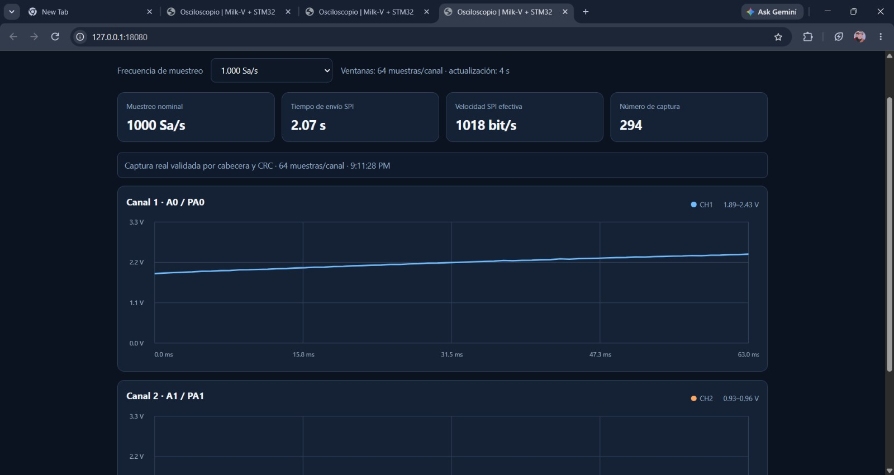
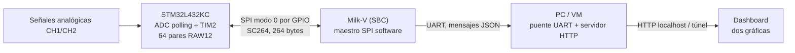
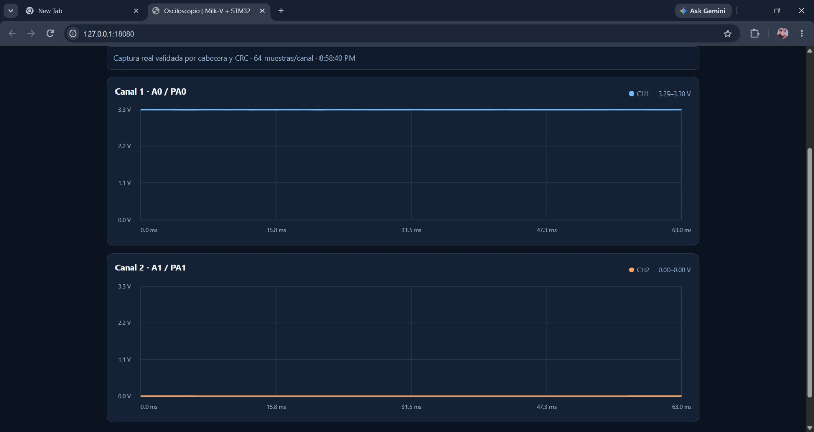
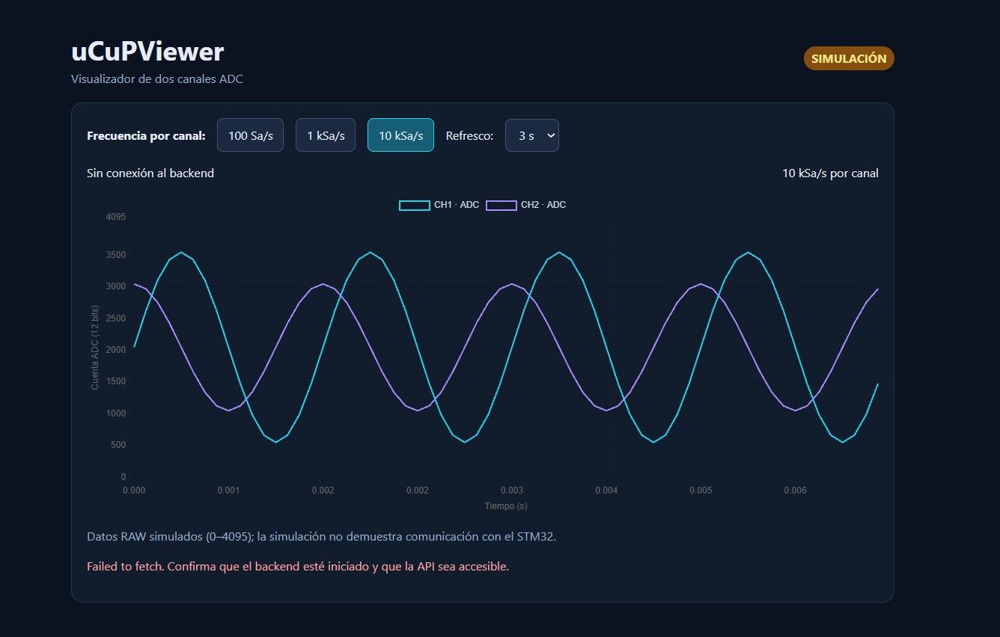

<div align="center">

# uCuPViewer

**Sistema híbrido de adquisición y visualización de dos señales analógicas**

STM32L432KC · Milk-V · SPI por GPIO · UART · HTTP · Dashboard web



*Captura del sistema con hardware, 64 muestras por canal y 1.000 Sa/s nominales. La frecuencia de adquisición no se midió de forma independiente.*

[Arquitectura](docs/portfolio/architecture.md) · [Cumplimiento](docs/portfolio/requirements.md) · [Pruebas y evidencias](docs/portfolio/evidence.md) · [Cómo reproducir](#ejecución-y-pruebas) · [Trabajo pendiente](docs/portfolio/roadmap.md)

</div>

> **Estado del proyecto (6 de noviembre de 2026): prototipo funcional parcialmente validado.** Se observaron tramas SC264 reales con CRC correcto y visualización HTTP desde un computador/VM. El servidor HTTP **no** corre aún en la Milk-V del montaje validado; no está demostrado experimentalmente el error/jitter de las frecuencias de adquisición ni la bonificación de 40 kSa/s.

## ¿Qué hace?

uCuPViewer nació de una práctica de interfaces de entrada/salida: construir un osciloscopio académico de dos canales con un microcontrolador y un SBC. La STM32 adquiere 64 pares de muestras ADC de 12 bits; la Milk-V solicita una ventana mediante un enlace eléctrico tipo SPI controlado por GPIO. Un puente UART en un PC/VM transforma las tramas recibidas en un estado JSON para un dashboard HTTP.

**No es un osciloscopio calibrado ni un instrumento de medición certificado.** No conectar entradas superiores a 3,3 V, negativas o desconocidas sin un acondicionamiento y protección adecuados.

## Arquitectura verificada y alcance



El recorrido anterior sí tiene respaldo de pruebas físicas. Nginx, el servicio HTTP directamente en Milk-V y los diseños alternativos DMA/SPI-hardware figuran como **implementaciones propuestas o históricas**, no como parte de esta validación. Véase [arquitectura y límites](docs/portfolio/architecture.md).

## Estado frente a los objetivos de clase

| Requisito | Estado sustentado |
| :-- | :-- |
| Dos canales ADC | Dos vectores de 64 muestras en tramas reales; independencia eléctrica sin caracterizar |
| 64 muestras por ventana | **Verificado** a nivel de estructura/trama y parser |
| 100 / 1.000 / 10.000 Sa/s | Presets implementados; exactitud **no medida**; 10.000 presentó error de periodo perdido |
| Comunicación SPI | **Verificada parcialmente** por GPIO/bit-banging, no con periférico SPI hardware |
| HTTP alojado en SBC mediante Apache/Nginx | **Pendiente** en el montaje probado: HTTP actualmente en PC/VM |
| Refresco entre 0,25 y 1 Hz | Configuración nominal de 4 s (0,25 Hz); cadencia visual real por medir |
| Tasas SPI teóricas y experimentales | Bitrate **efectivo** medido en pruebas; máximo teórico de ambos extremos pendiente |
| Captura ≥40 kSa/s | **No demostrado** |

La [matriz completa](docs/portfolio/requirements.md) incluye criterios, método de comprobación y evidencia por requisito. Nada de convertir un preset seleccionado en una medición de frecuencia, porque el ADC no funciona a base de optimismo.

## Resultados visibles

| Hardware | Simulación |
| :--: | :--: |
|  |  |
| Captura real con estado de cabecera/CRC válido; no valida tensiones con instrumento externo | Fixture sintético, **no** evidencia física de comunicación |

Más fotografías, un video de demostración y la explicación de qué valida cada recurso están en [evidencias](docs/portfolio/evidence.md). El video permanece enlazado desde Drive para evitar republicar una grabación que contiene personas.

## Ejecución y pruebas

### Validaciones offline (sin placas)

Requiere Python 3 con biblioteca estándar. Desde la raíz:

```bash
python3 -B -m unittest discover -s tests/milkv_uart -p 'test_*.py' -v
python3 -m py_compile backend/milkv_uart/milkv_stream.py backend/milkv_uart/pc_dashboard_uart.py
```

El primer comando prueba parser, CRC, formato SC264, errores y saneamiento de la consola UART. **No prueba** GPIO físico, ADC, temporización, Nginx o red. También se ejecuta en [GitHub Actions](.github/workflows/offline-tests.yml).

### Vista de demostración local

```bash
python3 backend/milkv_uart/pc_dashboard_uart.py --demo --http-port 8080
```

Abrir http://127.0.0.1:8080/ . En este modo las señales son sintéticas y se etiquetan como demo.

### Captura real con el montaje ya preparado

Solo en el entorno Linux con consola UART, pinmux/GPIO de Milk-V configurados y firmware correspondiente en la STM32:

```bash
python3 backend/milkv_uart/pc_dashboard_uart.py --serial /dev/ttyUSB0 --http-port 8080
```

El script introduce un capturador temporal en la consola **root** de Milk-V. Revisar primero [las condiciones del montaje](docs/architecture/estado_actual.md) y el [diagnóstico UART](docs/debug/milkv_dashboard_uart_validacion.md); no se debe ejecutar a ciegas, abrir Minicom al mismo tiempo ni asumir un dispositivo serial fijo. El servidor escucha solo en `127.0.0.1` del PC.

### Compilación del firmware actual

```bash
pio run -d firmware/stm32/spi_polling -e nucleo_l432kc
```

Proyecto PlatformIO independiente. No mezclar con `firmware/stm32/src/`, que conserva una implementación previa ADC + DMA. Compilar no equivale a validar la adquisición real.

## Navegación del repositorio

| Carpeta | Contenido |
| :-- | :-- |
| `firmware/stm32/spi_polling/` | Firmware actual STM32 ADC polling y SPI por GPIO |
| `backend/milkv_uart/` | Capturador Milk-V y puente UART/HTTP del computador |
| `frontend/uart_dashboard/` | Dashboard HTML/JS |
| `tests/milkv_uart/` | Pruebas unitarias offline de protocolo y consola |
| `docs/portfolio/` | Vista pública: arquitectura, matriz, evidencia y mejoras |
| `docs/protocol/` y `docs/debug/` | Especificaciones detalladas y bitácoras de diagnóstico |
| `infrastructure/` | Propuesta anterior para Raspberry Pi / Nginx; no desplegada aquí |
| `reference/prueba_1...6/` | Iteraciones históricas, **no** seis implementaciones activas |
| `reference/profesor/` | Material de referencia atribuido al docente; revisar permisos de redistribución |

## Equipo, procedencia y uso de IA

Este repositorio es un **fork de [anhenaobe/uCuPViewer](https://github.com/anhenaobe/uCuPViewer)**, desarrollado en equipo. El fork sirve como registro de aprendizaje y portafolio; **no implica autoría individual de todo el código**. Los roles previstos y el historial de contribuciones están en [roles](docs/02_roles_responsabilidades.txt), [guías por integrante](docs/por_integrante/) y el [registro de IA](docs/07_aportes_ia.txt). Ver [atribución y notas de publicación](docs/portfolio/credits.md).

La documentación de presentación se refinó después de la entrega académica. Los resultados de las pruebas originales y los fallos registrados no se reescribieron. Licencia presente: [GPL-3.0](LICENSE), con la salvedad de los materiales de terceros documentada en créditos.

