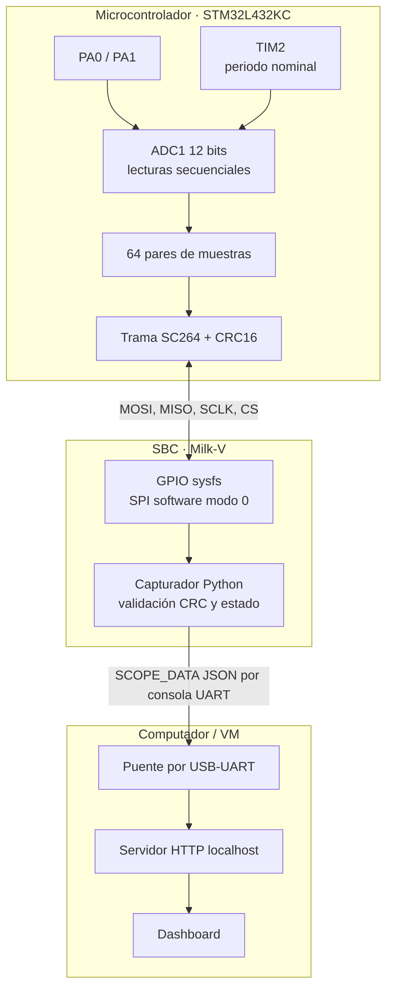
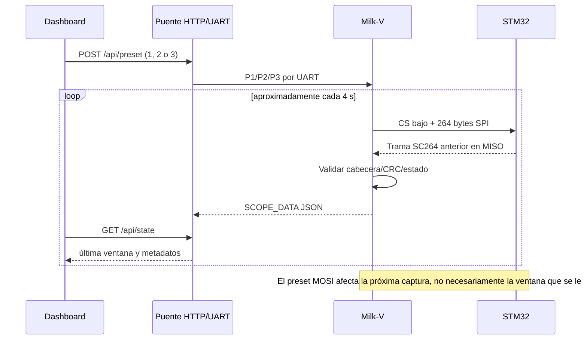

# Arquitectura y decisiones de diseño

**Corte documental:** 2026-11-06. Descripción del prototipo que cuenta con evidencia física, no del sistema ideal.

## Bloques y responsabilidades

Las conexiones SPI están declaradas en [`docs/protocol/spi_software.md`](../protocol/spi_software.md). Los números GPIO/rotulados físicos están sujetos a la configuración real de pinmux. Siempre se requiere GND común y niveles compatibles a 3,3 V.

## Secuencia nominal

## Formato de la ventana activa

| Campo | Bytes | Significado |
| :-- | :-- | :-- |
| Firma `SC` | 0–1 | `0x53 0x43` |
| Preset | 2 | 1=100, 2=1.000, 3=10.000 Sa/s nominales |
| Estado | 3 | 0=OK; otros valores indican errores |
| Secuencia | 4–5 | entero uint16 little-endian |
| Datos | 6–261 | 64 pares CH1/CH2; uint16 LE por muestra RAW12 |
| CRC16 | 262–263 | CCITT-FALSE sobre bytes 0 a 261, LE |

**Total:** 264 bytes, 2.112 bits por transferencia full-duplex. Fuente de verdad: [documento SC264](../protocol/frame_sc.md). El [contrato v0.2](../03_contratos_interfaces_v0_2.txt) usa 268 bytes y **no es compatible**; no mezclar mensajes.

## Decisiones y limitaciones

- **SPI por software:** ambos extremos intercambian reloj y datos tipo SPI, pero la Milk-V usa GPIO + `sleep` de Linux, no un controlador SPI dedicado. Está documentada una restricción del montaje; su causa técnica exacta no está demostrada.
- **Adquisición polling:** el código revisa el temporizador e inicia conversiones secuenciales por software. No hay disparo ADC hardware por timer ni DMA en la implementación activa. La tasa solicitada puede diferir de la real y tener jitter.
- **Servidor HTTP en PC/VM:** actualmente el acceso de red se realiza desde el computador. Las plantillas Nginx del repositorio son una propuesta, **no un servicio certificado en el SBC**.
- **Persistencia:** el puente instala el capturador en memoria por UART. No es un despliegue autónomo del sistema.
- **Sin ACK robusto de preset:** la primera posición MOSI es una orden, no confirmación de aplicación. La UI debe distinguir preset pedido y reportado.
- **Escalado eléctrico:** el dashboard multiplica RAW por 3,3/4095, suponiendo Vref=3,3 V. Ese factor no equivale a calibración de Vref, offset o ganancia.

## Diseño alternativo preservado

`firmware/stm32/src/` contiene ADC+TIM2+DMA de un trabajo previo. `reference/prueba_5/` reúne otra integración candidata con Nginx en Milk-V. No se debe combinar automáticamente con la versión que sí tiene evidencia física. El criterio para promover una alternativa sería compilar, programar, medir 64 muestras en ambas entradas, probar el SPI y servir HTTP directamente desde el SBC, todo con registros versionados.

