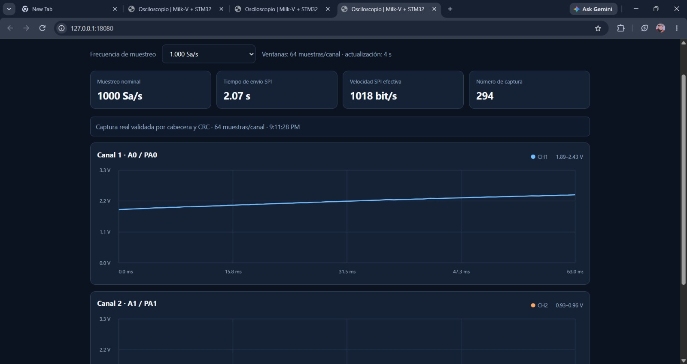
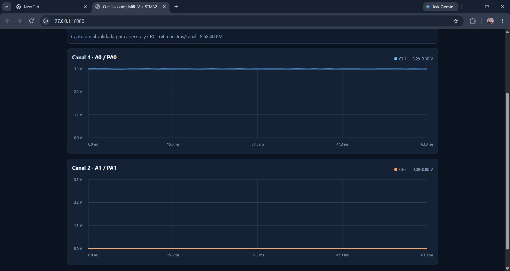
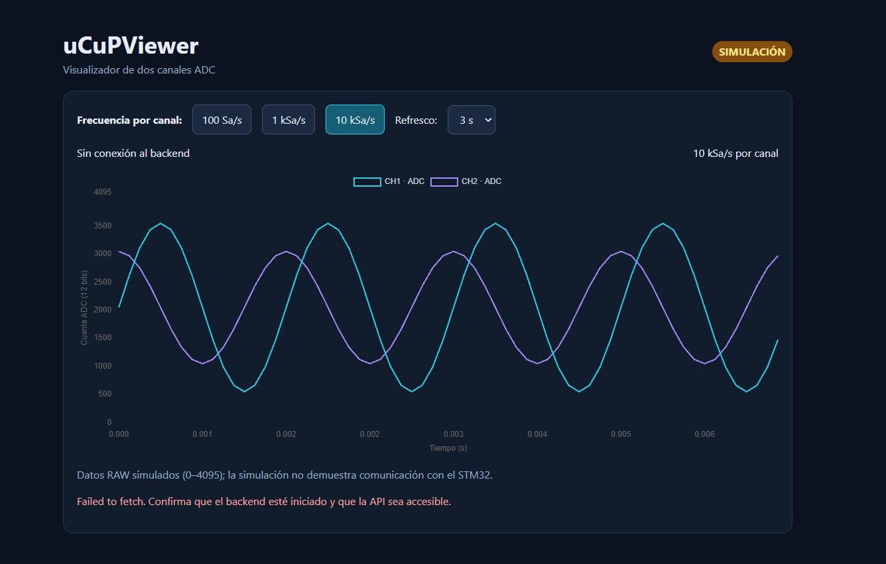

# Galería y trazabilidad de evidencias

**Fuentes:** fotografías y video aportados por el equipo en [carpeta de Drive](https://drive.google.com/drive/folders/1jr1CUwA_ebpVw6qE7oVa2Q1VVacG19S4), consultados el 6 de noviembre de 2026.

## 1. Captura en hardware con telemetría SPI

[Archivo original en Drive](https://drive.google.com/file/d/1XC1Lb6zDHuINY0NhyxNkcTcQffeHBc_X/view)

**Lo que se observa:** dashboard servido en `127.0.0.1:18080` del PC, preset `1.000 Sa/s`, 64 muestras/canal, captura número 294, SPI 2,07 s y ~1.018 bit/s efectivos. El cuadro informa que la trama pasa cabecera y CRC. Se ve CH1 y parte de CH2.

**No permite concluir:** que el ADC muestree exactamente a 1.000 Sa/s, que 2,07 s sea el tiempo de adquisición, o que el servidor HTTP esté corriendo en Milk-V.

## 2. Dos canales visibles

[Archivo original en Drive](https://drive.google.com/file/d/1Qsk3-cmsXhliMLaqWeyjsVIM2Y8Zsw0U/view)

**Lo que se observa:** CH1 próximo a 3,3 V; CH2 próximo a 0 V; 64 muestras por canal, rango y eje temporal calculados por software. Corrobora el funcionamiento de la interfaz con datos reportados como hardware.

**No permite concluir:** calibración eléctrica, precisión absoluta ni aislamiento entre canales bajo estímulos alternos.

## 3. Interfaz simulada, etiquetada

[Archivo original en Drive](https://drive.google.com/file/d/1b_-HvaCOrg_C3ZZbWI6uWhYdTQ2UTPaP/view)

**Lo que se observa:** dos señales sintéticas, presets y refresco seleccionables, etiqueta SIMULACIÓN y error de conexión al backend. Esta captura documenta diseño/UX, **no una medición con STM32**. Corresponde a una variante de UI; no asumir que cada control visual coincide con el frontend actual.

## 4. Video de demostración

[Ver grabación original (Drive)](https://drive.google.com/file/d/1PDse3BimbU5dBGboF4b08yXG3c-EYo62/view)

Archivo de 10,67 s, formato MP4. Se ve un dashboard abierto en un computador físico, una forma de onda y la interacción con el selector de frecuencia. La grabación **no** contiene una medición externa del periodo ADC ni certifica el preset 10 kSa/s.

**Privacidad:** el video muestra personas en el entorno. Se conserva como enlace a Drive sujeto a los permisos del propietario y no se republica en GitHub sin confirmar su consentimiento. Las tres imágenes de interfaz sí se copiaron como imágenes de documentación del fork.

## 5. Bitácora de ensayos y diagnósticos

- [Validación física SC264 post-SysTick](../debug/milkv_validacion_post_systick.md): tres transacciones reales con CRC válido.
- [Puente UART/HTTP](../debug/milkv_dashboard_uart_validacion.md): acceso a datos reales, 37 capturas observadas y **dos fallos de parsing UART** en la sesión; recuperación después de incidencias.
- [Diagnóstico SPI](../debug/milkv_spi_diagnostico.md): investigación y recuperación inicial.
- [Validación offline](../reviews/integracion_validacion.md): pruebas que no requieren placas.

Las imágenes y el video son **evidencia observacional**, no sustituyen el registro crudo de medidas. Para futuros ensayos, adjuntar CSV/JSON de capturas, configuración del instrumento y SHA del firmware.

